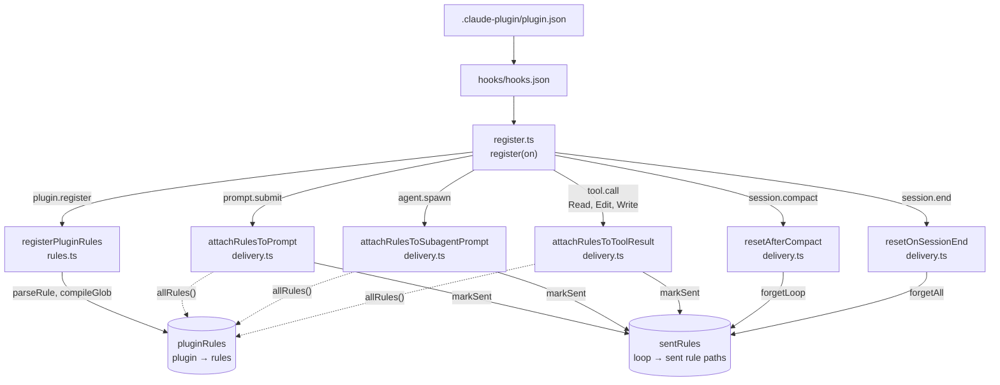
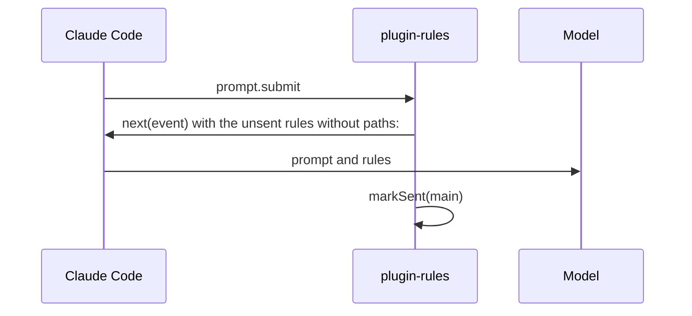
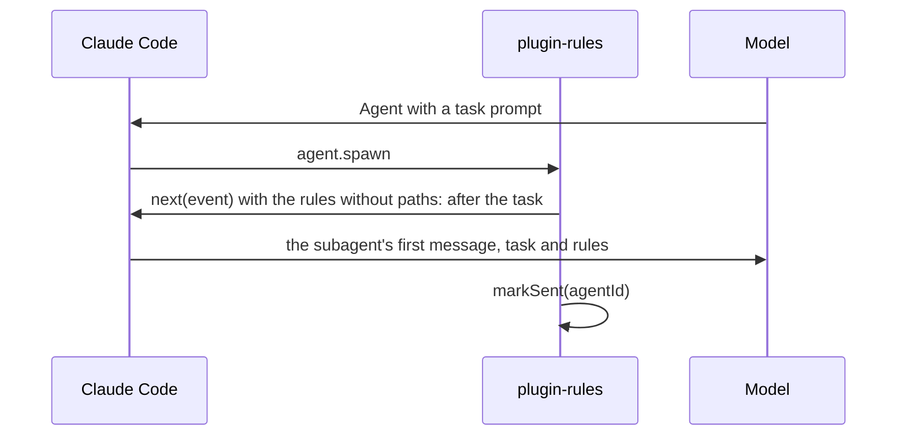
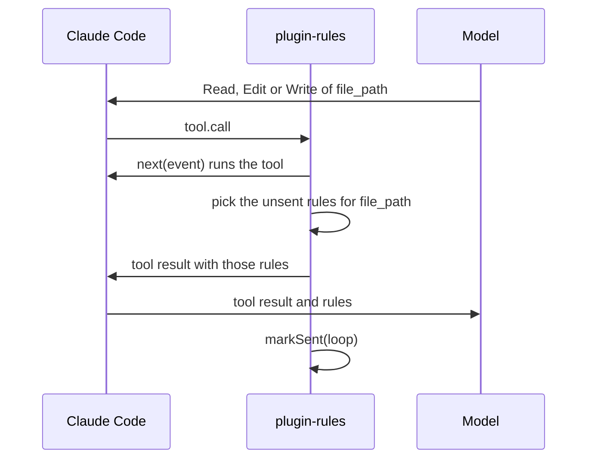

# plugin-rules

Delivers the `rules/*.md` of installed plugins to Claude. Claude Code loads rules only from
`.claude/rules/` and `~/.claude/rules/`, never from a plugin, so without this mod a plugin's
rules had to be copied there by hand. With it, the rules always match the installed plugin
version and there is nothing to copy or update.

Requires Claude Code 2.1.328 or newer.

## Install

Claude Code only

```sh
claude plugin marketplace add lachtan/nicecode
claude plugin install plugin-rules@nicecode
```

To try local changes without installing, run `claude --plugin-dir mods/plugin-rules`.

## How the rules reach Claude

Each rule goes to Claude at most once per conversation, as a reminder that starts
`Contents of <path> (rules from the <plugin> plugin):`. This is how Claude Code itself
delivers a rule with `paths:`.

- A rule without `paths:` goes along with the first prompt, or with the first `Read`, `Edit`
  or `Write`.
- A rule with `paths:` goes along with the first `Read`, `Edit` or `Write` of a file one of its
  globs matches. The path is matched relative to the working directory.
- A subagent starts with the rules without `paths:` at the end of its prompt; a rule with
  `paths:` follows with a matching `Read`, `Edit` or `Write`.
- After a compaction or `/clear`, the rules are sent again.

A rule without frontmatter, or without `paths:` in it, applies to every file. Only a block list
under `paths:` is read:

```yaml
---
paths:
  - "**/*.sh"
---
```

A glob may use `**/`, `**`, `*`, `?` and `{a,b}`; every other character is literal.

A rule whose `paths:` cannot be read this way is skipped, rather than applied to the wrong files:
an inline list, a string, no item under the key, or a glob with an unclosed `{`. The debug log
(`claude --debug`) names each skipped rule.

Within a plugin the rules are sent in the order of their file names.

## How it works

Claude Code reads `.claude-plugin/plugin.json`, finds `hooks/hooks.json` and loads the module it
lists, `hooks/register.ts`. The engine calls `register(on)`, which subscribes six handlers to
engine events. Each handler is middleware: it gets `(engine, event, next)`, calls `next` to let the
event go on, and looks at the result (`refuse`, `deny`, `drop`, `skip`) before it acts.

The mod keeps two maps in memory. `pluginRules` holds the parsed rules of each plugin.
`sentRules` holds the rules each loop has already been sent; a loop is the main conversation
(`main`) or a subagent (its `agentId`). `glob.ts` compiles the `paths:` globs and turns a tool's
`file_path` into a path relative to the working directory.

Solid arrows write to a map, dotted ones only read it.



### A session, step by step

**Startup.** For each plugin that registers after plugin-rules (`plugin.register`), the mod
reads `<root>/rules/*.md` in name order, parses `paths:` and skips a rule it cannot read.

**The user sends a prompt.** The rules without `paths:` that the main loop has not had yet go
along with the prompt.



Nothing is added to a slash command or when no rule is left to send; a dropped prompt is not
marked as sent.

**The model starts a subagent.** The rules without `paths:` go at the end of its task prompt.



A fork, a resumed run and a workflow agent get nothing here; a denied spawn is not marked as
sent.

**The model uses a file tool**, in the main loop or a subagent. The tool runs first, then its
result carries the unsent rules without `paths:` and those whose glob matches `file_path`.



A denied call gets no rules.

**The context is gone.** After `session.compact` (not a precompute, not skipped) the mod
forgets what that loop was sent (`forgetLoop`); after `session.end` with reason `clear` or
`resume` it forgets everything (`forgetAll`). The rules then go again.

## Known trade-offs

- Reloading the mod (`/reload-plugins`, or **Apply** in `skill-toggle`) forgets what was sent,
  so each rule is sent once more. That costs a few kB of tokens.
- A fork, a resumed subagent and a workflow agent do not get the rules in their prompt. A fork
  and a resumed subagent already hold them; a workflow agent takes them with its first `Read`,
  `Edit` or `Write`.
- The rules show as the end of the subagent's task prompt.
- Only the files directly in `rules/` are read, not those in its subfolders.
- `NotebookEdit` triggers no rules, so a rule with `paths:` for `*.ipynb` is sent only when the
  notebook is read with `Read`.
- A plugin that is itself a mod (it has a hooks module) may register before this one, and its
  rules are then not seen. Keep rules in a plugin without a hooks module.
- Claude Code's own background agents (compaction, memory) also get rules when they read
  files. This is harmless.
