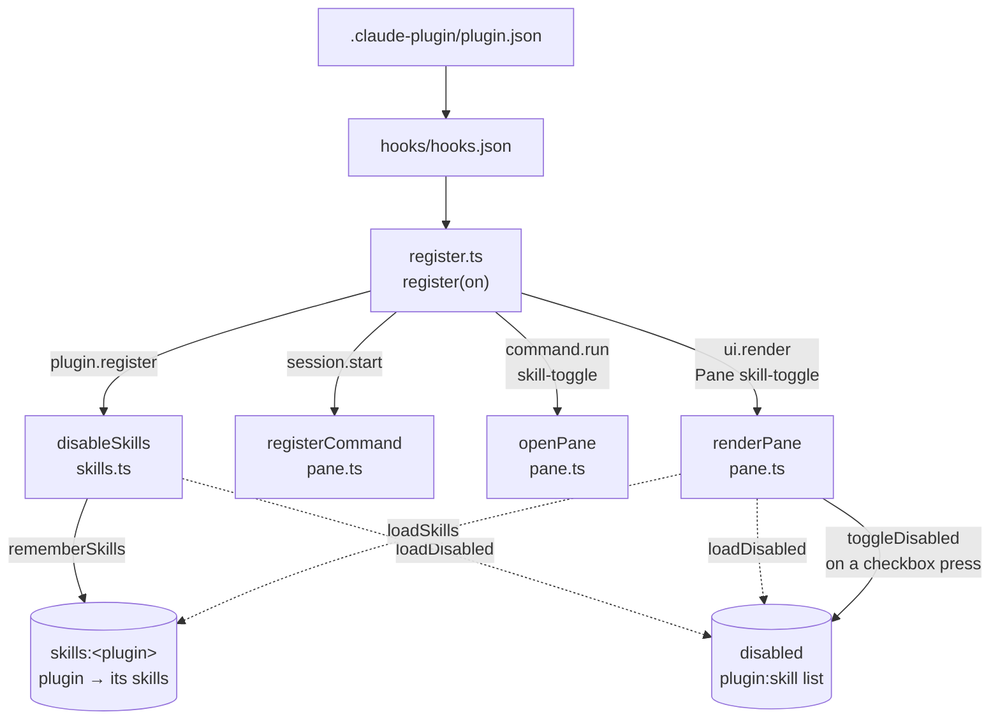
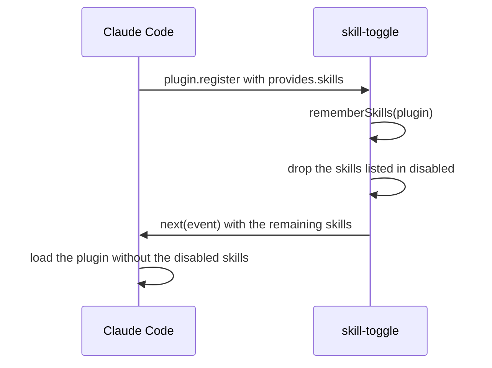
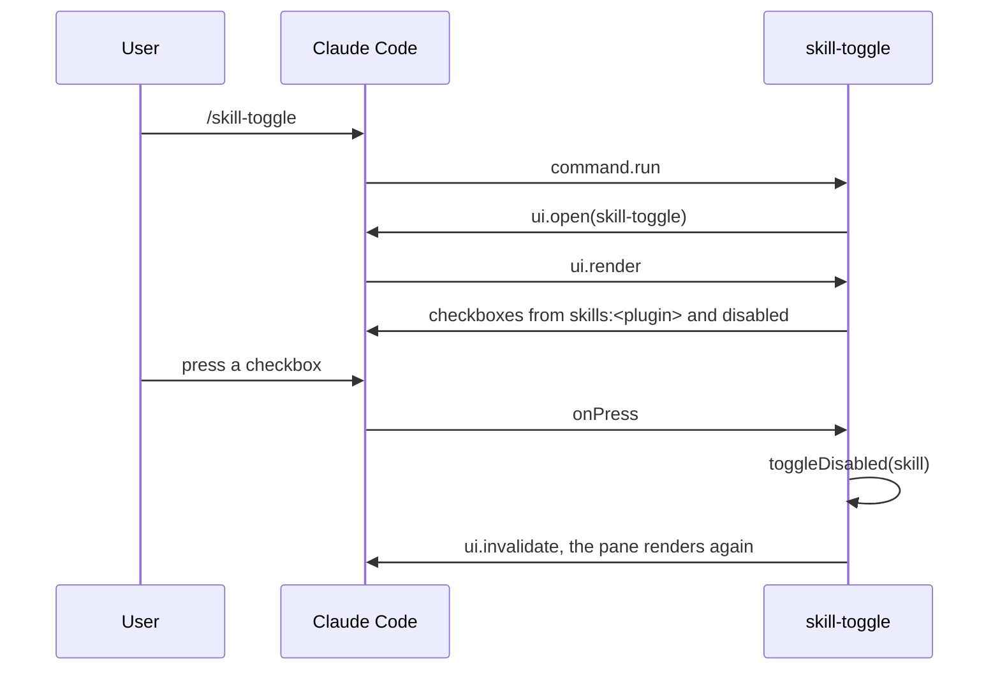
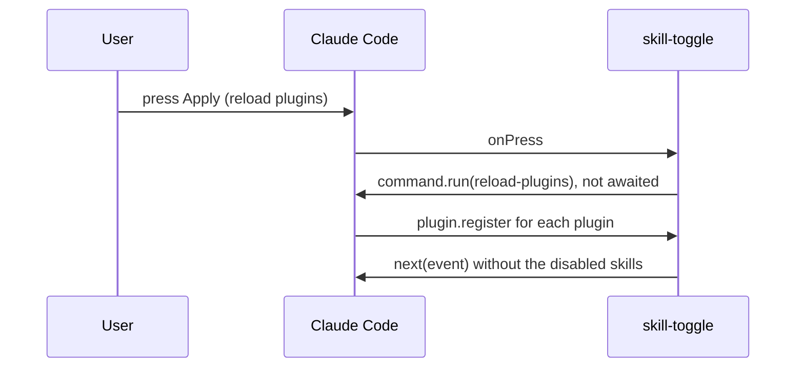

# skill-toggle

Turn off individual skills of installed plugins. All skills stay on until you turn one off.
Claude Code's `/skills` menu turns off project and personal skills only, so without this mod a
plugin skill could be turned off only together with its whole plugin.

Requires Claude Code 2.1.328 or newer.

## Project and personal skills

This mod covers plugin skills only. To turn off a skill from `.claude/skills/` (project) or
`~/.claude/skills/` (personal), use Claude Code's own `/skills` menu: highlight the skill, press
`Space` until it shows `off`, then `Esc`. The choice is saved under `skillOverrides` in
`.claude/settings.local.json`, which stays out of git, so it applies only to you in that project:

```json
{ "skillOverrides": { "deploy": "off" } }
```

## Install

Claude Code only; Codex does not run mods.

```sh
claude plugin marketplace add lachtan/nicecode
claude plugin install skill-toggle@nicecode
```

To try local changes without installing, run `claude --plugin-dir mods/skill-toggle`.

## Use

1. Run `/skill-toggle`. A pane lists every plugin skill.
2. Uncheck the skills you want off (`[x]` = on, `[ ]` = off).
3. Press **Apply (reload plugins)**. Unchecked skills no longer load, so Claude cannot see or run them.

Your choice applies to every project and is kept across sessions.

## Where the choice is stored

`~/.claude/plugins/store/skill-toggle_<id>.json`, key `disabled`:

```json
{ "disabled": ["core:commit", "lab:debug"] }
```

Each entry is `<plugin>:<skill>`. You can edit the list by hand; it takes effect after
`/reload-plugins` or in a new session. The `skills:<plugin>` keys in the same file only list every
skill of each plugin for the pane. An uninstalled plugin stays in the pane until you delete its
`skills:<plugin>` key (and its entries in `disabled`).

A marketplace install and a `--plugin-dir` run may use different files, so the choice made in
one does not carry over to the other.

## How it works

Claude Code reads `.claude-plugin/plugin.json`, finds `hooks/hooks.json` and loads the module it
lists, `hooks/register.ts`. The engine calls `register(on)`, which subscribes four handlers to
engine events: `plugin.register`, `session.start`, `command.run` for the `skill-toggle` command
and `ui.render` for the `skill-toggle` pane. Each handler gets `(engine, event, next)`;
`disableSkills` is middleware that calls `next` with a shorter list of skills.

The mod keeps everything in its store (`engine.store`). `skills:<plugin>` holds every skill a
plugin ships, because a disabled skill no longer loads and the pane would not know about it
otherwise. `disabled` holds the skills turned off. Each plugin has a key of its own, so plugins
that register at the same time never overwrite each other.

Solid arrows write to the store, dotted ones only read it.



### A session, step by step

**A plugin loads.** For each plugin that registers after skill-toggle (`plugin.register`), the
mod saves the plugin's skills under `skills:<plugin>`, removes the disabled ones from the event
and passes it on. Claude Code then loads only the skills that are left.



**The session starts.** On `session.start` the mod registers the `/skill-toggle` command.

**The user runs `/skill-toggle`.** `openPane` opens the pane, and every `ui.render` of it reads
the store and draws a checkbox for each skill. Pressing a checkbox flips the skill in `disabled`
and asks for a redraw.



**The user presses Apply.** The mod runs `/reload-plugins` without waiting for it, because the
reload loads this mod again while the handler still runs. Every plugin then registers again and
goes through `disableSkills` with the new list. A failed reload shows a toast.



## Known trade-offs

- A change takes effect only after a reload, because skills are read when a plugin loads.
- **Apply** reloads every plugin, not just the one whose skills changed. A mod that keeps state in
  memory, such as `plugin-rules`, starts over.
- A plugin that is itself a mod (it has a hooks module) may register before this one. Its skills
  then do not show in the pane and cannot be turned off.
